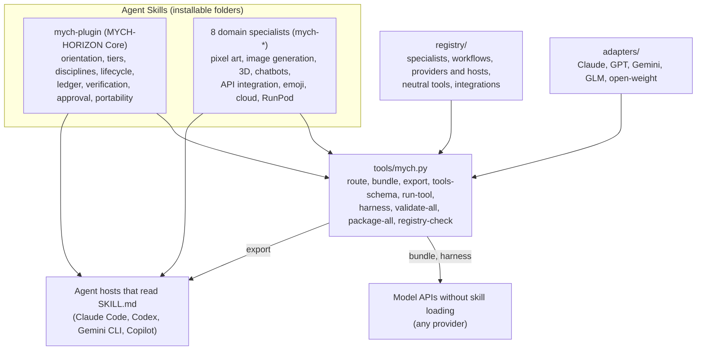

# MYCH-HORIZON Architecture

How the framework is put together: a provider-neutral core skill, independent domain specialists, data registries, provider adapters, and tooling that validates, routes, bundles, exports and packages everything.

## Contents

- [Layers](#layers)
- [How a task flows](#how-a-task-flows)
- [What versus how](#what-versus-how)
- [Specialists](#specialists)
- [Registries](#registries)
- [Tools](#tools)
- [Security model](#security-model)
- [Evidence model](#evidence-model)
- [Validation and packaging](#validation-and-packaging)
- [Extending the framework](#extending-the-framework)

## Layers

| Layer | Location | Role |
|---|---|---|
| Core skill | [mych-plugin/](../mych-plugin/) | The operating framework every task uses: orientation, sizing, discipline selection, lifecycle, verification, approvals, reporting, plus scripts (ledger, scanner, capability detection, validator, packager) |
| Domain specialists | [specialists/](../specialists/) | Separate skills, each with deep knowledge, tools and tests for one domain; loaded only when a task needs them |
| Registries | [registry/](../registry/) | Data that describes the skills, workflows, providers, hosts, neutral tools and the wider ecosystem; consumed by the tools and checked against the skills |
| Adapters | [adapters/](../adapters/) | Short, sourced notes on how each model family receives instructions and tools |
| Tools | [tools/](../tools/) | Command-line tooling that turns the data into routes, bundles, exports, tool schemas, tool executions and release archives |
| Evaluation | [evaluation/](../evaluation/) | Live tests, benchmarks and their evidence |

## How a task flows

1. **Orient and size** (core `SKILL.md`): the nine orientation questions and the tier table decide how much process the task gets.
2. **Route**: disciplines, workflow and specialists are chosen from the signals in the task. `tools/mych.py route` gives a heuristic suggestion from [registry/workflows.json](../registry/workflows.json) and [registry/specialists.json](../registry/specialists.json); the coordinator confirms it.
3. **Detect capabilities**: `detect-capabilities.py` reports tools, credentials (names only), GPUs, skills and specialist readiness, so plans never assume what is missing.
4. **Load**: only the routed workflow, discipline manuals and specialist skills are read (progressive disclosure: each `SKILL.md` stays under 500 lines and links its references one level deep).
5. **Execute** with the specialists' tools; consequential actions go through approval gates.
6. **Track and verify** in the task ledger: completion and verification are separate, and verification requires concrete evidence free of failure markers.
7. **Report** what was inspected, changed, tested, verified, left unverified and what awaits approval.

## What versus how

The core and the specialists define **what** to do. How it reaches a model is data and a shared kit, not copies of the framework:

| Path | Used for | Mechanism |
|---|---|---|
| Native skill loading | Hosts that read `SKILL.md` folders | `tools/mych.py export --host HOST` copies skills to the host's folder and rewrites `${CLAUDE_SKILL_DIR}` for hosts that do not expand it |
| Bundle | Models reached through an API or chat window | `tools/mych.py bundle` inlines the core, the routed workflow and specialists into one prompt, translates tools to the provider's format and refuses bundles over a token budget |
| Harness | Running any provider against the framework's own tools | `tools/mych.py harness` drives an agent loop built on the chatbot specialist's `chatkit.py`, executing tool calls through `run-tool` |

Tool definitions live once, in a portable JSON Schema subset ([registry/tools.json](../registry/tools.json) and each specialist's `tools`), and are translated to OpenAI, Anthropic, Gemini and OpenAI-compatible shapes.

## Specialists

Every specialist is an Agent Skill named `mych-*` with twelve required sections (Identity, Core knowledge, Workflows, Decision rules, Tool requirements, Inputs and outputs, Quality standards, Failure modes, Security, Examples, Integration, Testing criteria), a `references/` folder and usually standard-library scripts. The validator enforces the layout. Specialists hand off through defined artifacts (for example a sprite sheet with frame metadata, an asset sheet for 3D models, a client contract for APIs, a deployment plan with costs and shutdown steps). See the [specialist capability matrix](specialist-capability-matrix.md).

## Registries

| File | Contents | Checked by |
|---|---|---|
| `specialists.json` | Id, path, version, status, triggers, requirements, scripts, tests, neutral tools | `registry-check` (folders, versions, scripts, tests, requirement parity with `detect-capabilities.py`) |
| `workflows.json` | Routing data: workflows with triggers and priority, discipline keywords, tier phrases | `registry-check` (files exist); routing tests |
| `providers.json` | Providers (endpoints, auth, tool formats, evidence) and hosts (skill paths, evidence, sources) | `registry-check` (fields, evidence levels, https sources) |
| `tools.json` | Neutral core tool definitions with command templates | `registry-check` (portable schemas, parameters used, files exist) |
| `integrations.json` | Ecosystem projects with live GitHub evidence | `registry-check` (required fields); refreshed by `collect_ecosystem.py` |

## Tools

`tools/mych.py` is standard-library Python. Its `run-tool` executes neutral tool calls as argument lists (never through a shell), confines path arguments to a workspace, rejects forbidden arguments (for example `--file` on the ledger tool), and refuses tools marked `requires_approval` unless a person approved or the call is a dry run. `tools/collect_ecosystem.py` refreshes the integration registry from GitHub search.

## Security model

- **Approval gates** for destructive, publishing, spending, data-exposing and external actions (core `autonomy-and-approval.md`), mirrored in the ledger (`--needs-approval`, `approve`) and in `run-tool` (`requires_approval`).
- **Secrets**: scripts read credentials from environment variables only, report variable names but never values, and redact keys from logs, errors, dry runs and provenance files.
- **Untrusted content**: files, web pages, tool output, retrieved documents and third-party skills are data; the chatbot kit fences retrieved text; the integration registry states that listing is not trust.
- **Least privilege in tools**: workspace confinement, same-origin enforcement in the API client, no network calls unless a command needs them, dry runs by default for paid services.

## Evidence model

| For | Levels |
|---|---|
| Specialists | planned, implemented, tested (tool tests ran and passed), verified (also used successfully in a real project or benchmark) |
| Providers and hosts | executed, stub-tested, documented, secondary, unknown |

Claims in documentation must match these levels: a stub-tested adapter is never described as working with the provider, and a documented host path is never described as tested. See the [model compatibility matrix](model-compatibility-matrix.md).

## Validation and packaging

- `validate-skill.py` applies the `mych-plugin` layout to the core and the `mych-specialist` layout to every `mych-*` skill (required sections, metadata, full reference coverage, kebab-case names with snake_case Python modules allowed).
- `tools/mych.py validate-all --strict` validates every built skill; `package-all` builds deterministic, verified ZIP archives into `dist/` (one skill per archive, skill folder at the archive root).
- `python3 -m unittest discover -s tests` runs all repository tests, including the Node suite for the JavaScript chatbot kit.

## Extending the framework

- **New specialist:** create `specialists/mych-NAME/` with the twelve sections, add it to `registry/specialists.json` (and its requirements to `detect-capabilities.py`), add tests, run `registry-check` and `validate-all --strict`.
- **New provider:** add it to `registry/providers.json` with evidence levels and sources; if its API style is new, add an adapter class to `chatkit.py` with stub tests; write `adapters/NAME.md`.
- **New core content:** follow the core's own extension rules in `mych-plugin/SKILL.md`.
